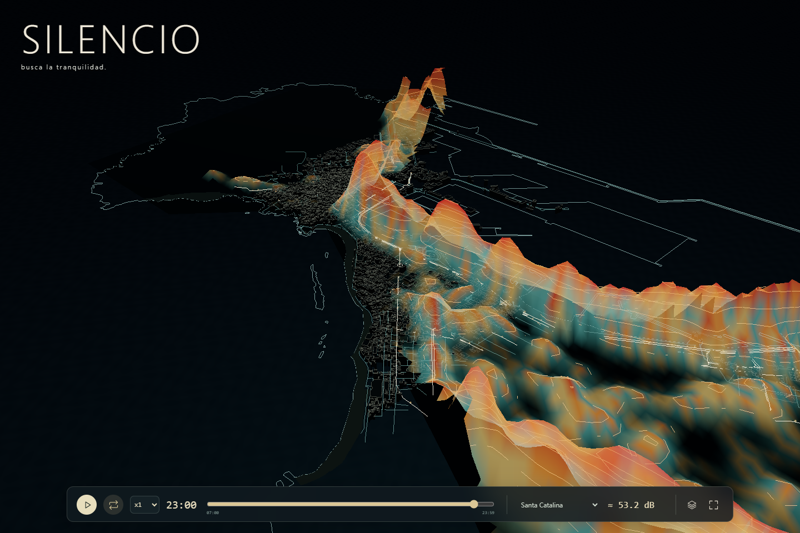

# SILENCIO

**Buscando la tranquilidad.**

* [Vídeo de demostración](https://youtu.be/hAxok_xTz6g)

### Autoría

* [Néstor J. Henríquez Medina](http://github.com/NestorJHM)
## Contenido

- [Cómo ejecutar el proyecto](#cómo-ejecutar-el-proyecto)
- [Instrucciones de uso](#instrucciones-de-uso)
- [Datos de la simulación](#datos-de-la-simulación)
- [Actualizar los datos y comprobar el proyecto](#actualizar-los-datos-y-comprobar-el-proyecto)
- [Referencias y fuentes](#referencias-y-fuentes)


Esta práctica, de la asignatura "Informática Gráfica", propone una visualización interactiva del ruido ambiental en Las Palmas de Gran Canaria. Combinamos los edificios y calles reales con un relieve acústico y una iluminación que cambia con la hora del día simulada.


*Vista nocturna de SILENCIO: visualización del ruido ambiental en Las Palmas de Gran Canaria.*

## Cómo ejecutar el proyecto

### Requisitos

- Instala **Node.js 22.12 o posterior**, que incluye **npm**.
- Utiliza un navegador actualizado con aceleración gráfica activada para mostrar el mapa 3D.

### Instalar y arrancar

1. Descarga o copia el proyecto y abre una terminal en su carpeta principal, donde se encuentra `package.json`.
2. Instala las dependencias. Este paso necesita conexión a Internet y se realiza la primera vez:

   ```bash
   npm install
   ```

3. Arranca el proyecto:

   ```bash
   npm run dev
   ```

4. Abre [http://127.0.0.1:5173/](http://127.0.0.1:5173/) en el navegador y espera a que se cargue el mapa.

Mantén la terminal abierta mientras usas la aplicación. Para detenerla, pulsa **Ctrl + C** en esa terminal. Las siguientes veces basta con ejecutar `npm run dev`.

Los mapas y la textura de la ciudad ya están incluidos en `public/data/`. Los comandos para actualizar esos datos se explican al final de este documento.

Si `npm install` falla dentro de una carpeta sincronizada con Google Drive, copia el proyecto a una carpeta local y repite la instalación allí.

### Preparar y probar la versión final

Desde la misma carpeta, ejecuta:

```bash
npm run build
npm run preview
```

El primer comando genera la versión final en `build/`. El segundo la sirve en [http://127.0.0.1:4173/](http://127.0.0.1:4173/). Mantén esa terminal abierta y pulsa **Ctrl + C** para detenerla.

### Instrucciones de uso

- El control de la vista se hace mediante el ratón:
    - Clic izquierdo rotamos la vista.
    - Clic derecho desplazamos el mapa.
    - Rueda del ratón para hacer zoom.

- Podemos mover la barra inferior horaria para ver la evolución de las bandas acústicas a través del tiempo.

- El selector de velocidad permite **x1, x4 y x8**. Se puede cambiar la velocidad durante la reproducción o en pausa. 
- El botón de **dos flechas** activa o desactiva la reproducción en bucle. Se puede arrastrar el deslizador durante la reproducción para continuar desde otra hora.
- El panel de la derecha muestra la zona seleccionada, su estimación acústica, la escala de ruido y las coordenadas. Puedes cambiar de zona con el selector o seleccionar un punto del mapa.
- El panel **Capas**, a la izquierda, permite mostrar u ocultar los edificios, las calles y el ruido ambiental. **Datos y licencia** muestra las fuentes utilizadas.
- El icono de vista alterna entre perspectiva y vista aérea.
- El icono de expansión muestra **solo el mapa**. Se vuelve con **Esc** o con el cierre de la esquina superior derecha, visible al pasar el ratón.
- La barra espaciadora alterna reproducción y pausa. 


## Datos de la simulación

La geografía procede de **© OpenStreetMap contributors**, bajo [Open Database License](https://www.openstreetmap.org/copyright). Se usan las alturas etiquetadas cuando existen y alturas ilustrativas deterministas cuando faltan; están exageradas para facilitar la lectura.


La superficie de la ciudad utiliza una **ortofoto real PNOA actual**, del [IGN / Sistema Cartográfico Nacional](https://pnoa.ign.es/web/portal/pnoa-imagen/ortofotos-pnoa-maxima-actualidad), con licencia [CC BY 4.0](https://www.ign.es/resources/licencia/Condiciones_licenciaUso_IGN.pdf). La imagen se guarda localmente en `public/data/las-palmas-pnoa.jpg`. Recibe las sombras y responde a la iluminación de la escena.

Las bandas acústicas proceden del [Mapa de Ruido del Ayuntamiento de Las Palmas de Gran Canaria](https://sit.laspalmasgc.es/server/rest/services/Medioambiente___Mapa_de_Ruido/MapServer): **Ld (día), Le (tarde) y Ln (noche)**, capas 16, 17 y 18. 

Los mapas se alinean por coordenadas sobre la rejilla diurna. Durante una transición solo se interpola donde ambos mapas tienen datos.

### Evolución acústica

`src/simulation.js` utiliza las horas ilustrativas **07:00 → día**, **19:00 → tarde** y **23:59 → noche**. Se ha optado por hacerlo de esta forma para poder dar un efecto de variación del ruido.

Para evitar una evolución a saltos se añade una fluctuación continua y suavizada.

Las luces móviles siguen los segmentos reales de las calles OSM. Su densidad favorece las vías con mayor nivel acústico y disminuye gradualmente al atardecer, manteniendo actividad nocturna. Son una representación ilustrativa del tráfico, sin conteos de vehículos medidos. Se ocultan junto con la capa **Calles**.

Las bandas utilizan la mitad de la altura visual anterior, manteniendo los mismos valores y colores de ruido. Al activar la capa ascienden desde el suelo en unos **1,1 segundos**; al desactivarla descienden suavemente. La transición puede invertirse sin saltos y se conserva durante la reproducción. El relieve incorpora paredes y base cerradas, con curvas de nivel continuas por los bordes, sin asignar mediciones a zonas sin cobertura.

### Luz solar y sombras

`src/daylight.js` define una trayectoria solar ilustrativa para la latitud de Las Palmas (**28,13° N**), donde  **amanecer es a las 07:00 y la puesta del sol a las 20:00**.

La altura de la luz del sol y su color cambian con la hora. La iluminación ambiente, el hemisferio, el fondo, la niebla y el agua también cambian para pasar progresivamente del amanecer al mediodía, al atardecer y a la noche. 

Los edificios proyectan sombras sobre el terreno y entre sí mediante un mapa de sombras de **4096 × 4096**. 

El relieve de ruido y las alturas urbanas son representaciones visuales, por lo que las sombras no deben interpretarse como algo exacto.

## Actualizar los datos y comprobar el proyecto

- `npm run data:refresh`: descarga geografía y los tres periodos acústicos.
- `npm run data:terrain`: regenera el recorte de costa y descarga la ortofoto PNOA alineada con `city.json`. Ejecutar tras actualizar la geografía.
- `node scripts/check-acoustic.mjs`: comprueba la altura, el cierre de la geometría y los contornos, y las transiciones reversibles.
- `node scripts/fetch-evening.mjs`: actualiza solo la tarde.

El proyecto usa Three.js y Vite.

## Referencias y fuentes

### Fuentes de los datos

- **[OpenStreetMap](https://www.openstreetmap.org/copyright)**: edificios, calles y línea de costa de Las Palmas de Gran Canaria. Datos de © OpenStreetMap contributors, bajo licencia ODbL.
- **[Mapa de Ruido del Ayuntamiento de Las Palmas de Gran Canaria](https://sit.laspalmasgc.es/server/rest/services/Medioambiente___Mapa_de_Ruido/MapServer)**: niveles de ruido ambiental del día, la tarde y la noche. Se utilizan las capas [16 · día (Ld)](https://sit.laspalmasgc.es/server/rest/services/Medioambiente___Mapa_de_Ruido/MapServer/16), [17 · tarde (Le)](https://sit.laspalmasgc.es/server/rest/services/Medioambiente___Mapa_de_Ruido/MapServer/17) y [18 · noche (Ln)](https://sit.laspalmasgc.es/server/rest/services/Medioambiente___Mapa_de_Ruido/MapServer/18).
- **[PNOA · IGN / Sistema Cartográfico Nacional](https://pnoa.ign.es/web/portal/pnoa-imagen/ortofotos-pnoa-maxima-actualidad)**: fotografía aérea utilizada para cubrir el terreno de la ciudad. Se conserva la atribución de la imagen conforme a las [condiciones de uso del IGN, CC BY 4.0](https://www.ign.es/resources/licencia/Condiciones_licenciaUso_IGN.pdf).

### Herramientas y documentación

- **[otsedom.github.io/IG/S7](https://github.com/otsedom/otsedom.github.io/tree/main/IG/S7)**: repositorio de documentación de la asignatura.
- **[otsedom.github.io/IG/S8](https://github.com/otsedom/otsedom.github.io/tree/main/IG/S8)**: repositorio de documentación de la asignatura.
- **[Three.js](https://threejs.org/docs/)**: creación del mapa 3D, iluminación, sombras y controles de cámara.
- **[Vite](https://vite.dev/guide/)**: arranque del proyecto en el navegador y preparación de la versión final.
- **[Node.js](https://nodejs.org/learn/getting-started/introduction-to-nodejs)**: ejecución de los comandos del proyecto.

