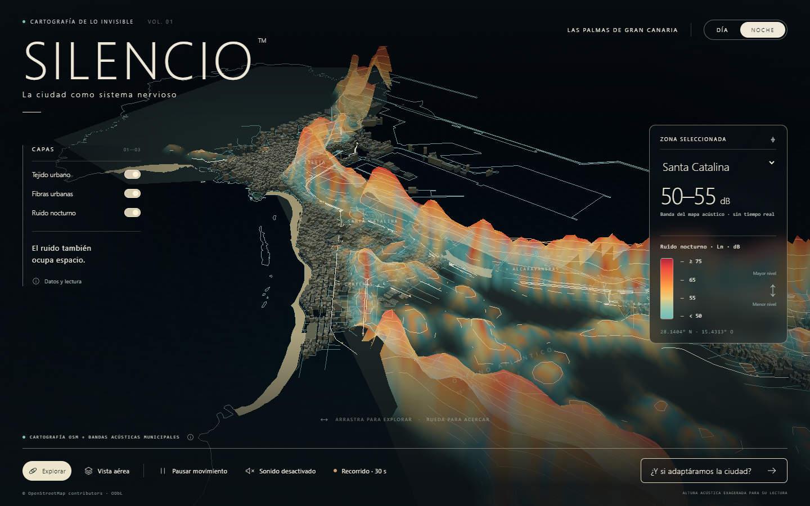

# SILENCIO™

### La ciudad como sistema nervioso

**SILENCIO™** es una presentación interactiva que explora el ruido ambiental de Las Palmas de Gran Canaria. Combina la geografía urbana con información acústica para transformar un fenómeno invisible en un paisaje tridimensional.

Las calles aparecen como fibras luminosas, los edificios forman el tejido de la ciudad y las bandas de ruido se elevan como membranas translúcidas. Esta metáfora presenta la ciudad como un organismo atravesado por estímulos y plantea una pregunta: **¿Y si adaptáramos la ciudad?**

[Ver el recorrido en vídeo · 30 segundos](docs/demo.mp4)

## Qué muestra la presentación

La escena permite observar cómo se distribuyen las bandas acústicas sobre una parte de la ciudad y comparar su representación durante el día y la noche. El color y la altura del relieve facilitan reconocer diferencias entre zonas, mientras que las transparencias permiten mantener visible el entorno urbano.

La presentación invita a reflexionar sobre el espacio que queda para quienes necesitan entornos con menos estímulos. Su perspectiva incorpora la diversidad de necesidades sensoriales sin atribuir una única forma de percibir la ciudad a todas las personas neurodivergentes.

## Alcance temporal de los datos

La presentación actual compara dos mapas agregados: el indicador de ruido diurno **Ld** y el nocturno **Ln**. Estos indicadores describen niveles medios a largo plazo de sus respectivos periodos, definidos sobre el conjunto de días o noches de un año. El año de referencia de las capas utilizadas no está identificado en los metadatos consultados.

Por tanto, la comparación muestra diferencias entre periodos agregados. No permite seguir las horas de una fecha concreta, reproducir una semana ni observar fluctuaciones horarias. Para incorporar esa lectura temporal es necesario disponer de registros acústicos fechados y con hora de observación.

## Qué puede explorar el espectador

- **Recorrer la ciudad:** girar la vista, acercarse a los detalles y alternar entre una perspectiva oblicua y una vista aérea.
- **Comparar el día y la noche:** observar los cambios entre las bandas acústicas de ambos periodos.
- **Separar las capas:** mostrar u ocultar los edificios, las fibras urbanas y el relieve acústico para examinar su relación.
- **Consultar lugares concretos:** seleccionar puntos del mapa o visitar Mesa y López, Las Canteras, Santa Catalina, Alcaravaneras y La Isleta para consultar el intervalo acústico disponible.
- **Explorar un umbral personal:** elegir un nivel de referencia y atenuar visualmente las bandas que quedan por encima, mediante la pregunta «¿Y si adaptáramos la ciudad?».
- **Regular la experiencia:** pausar las animaciones y activar, si se desea, un acompañamiento sonoro artístico.
- **Seguir un recorrido automático:** contemplar la escena mediante una trayectoria de cámara de 30 segundos.

## Cómo interpretar la visualización

| Elemento visual | Significado |
| --- | --- |
| Edificios y calles | Distribución geográfica del tejido urbano. |
| Fibras luminosas | Interpretación de las calles como conexiones de un organismo. |
| Membranas de color | Representación de las bandas de ruido ambiental. |
| Altura del relieve acústico | Mayor altura para bandas de mayor nivel sonoro. |
| Intervalo en decibelios | Banda acústica disponible en la muestra más próxima al punto seleccionado. |
| Selector día/noche | Comparación de los indicadores de ruido diurno y nocturno. |

El relieve está exagerado y suavizado para facilitar su lectura. Las alturas acústicas son una representación visual de los intervalos sonoros. Las alturas de los edificios también están adaptadas para hacer visible el tejido urbano.

Los pulsos de las fibras y el acompañamiento sonoro forman parte de la propuesta artística. Las bandas acústicas corresponden a cartografía publicada, por lo que la presentación no describe lo que está sonando en ese instante.

Cuando un punto carece de información, se indica como **sin datos**. La ausencia de información no permite concluir que exista silencio. El porcentaje mostrado al explorar un umbral se refiere a muestras acústicas disponibles, no a población.

## Información representada

La geografía procede de **© OpenStreetMap contributors**, bajo [licencia Open Database License](https://www.openstreetmap.org/copyright).

Las bandas de ruido diurno y nocturno proceden del [Mapa de Ruido del Ayuntamiento de Las Palmas de Gran Canaria](https://sit.laspalmasgc.es/server/rest/services/Medioambiente___Mapa_de_Ruido/MapServer), con los indicadores **Ld** y **Ln**, respectivamente. La fecha del estudio no consta en los metadatos consultados, por lo que no se atribuye la información a un año concreto.

El ámbito mostrado es una parte de Las Palmas de Gran Canaria. La cobertura de edificios es parcial en el suroeste y el contorno del suelo está simplificado.

## La pregunta final

**¿Cuánto espacio deja la ciudad para quienes necesitan menos estímulos?**

SILENCIO™ propone observar el entorno desde esa pregunta y considerar la adaptación de los espacios compartidos a distintas necesidades sensoriales.

